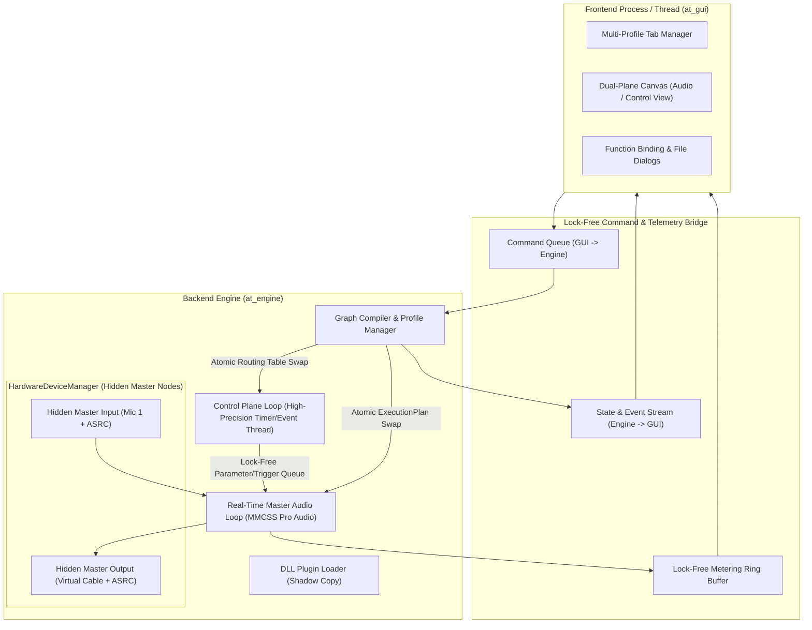
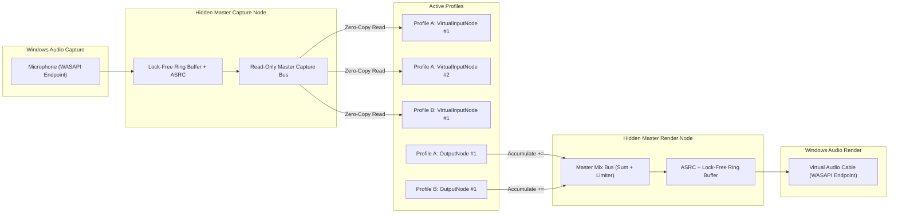

# 01 — High-Level Architecture, Audio Engine & Control Loops

## 1. System Topology Overview

AudioTool (AT) is divided into two strictly decoupled subsystems:
1. **The Audio & Control Backend Engine (`at_engine`)**: Owns hardware audio endpoints, DLL plugin lifecycles, active workspace profiles, the real-time audio graph scheduler, and the control signal dispatcher.
2. **The Frontend GUI (`at_gui`)**: A visual graph editor and control surface that sends asynchronous commands to the backend and renders state/telemetry snapshots.

---

## 2. Multi-Thread Architecture & Control Loops

To achieve ultra-low latency (< 10 ms round-trip) without audio dropouts, the backend separates execution into **four distinct thread domains**.

### 2.1 Loop 1: The Real-Time Audio Processing Loop (`AudioThread`)
- **Scheduling:** Runs under Windows **MMCSS (Multimedia Class Scheduler Service)** with the `"Pro Audio"` task profile (`AvSetMmThreadCharacteristicsW`), elevated to `THREAD_PRIORITY_TIME_CRITICAL`.
- **Pacing:** Driven by a single **Master Audio Clock** (either the primary WASAPI Output Endpoint's event-driven callback, or a high-precision waitable timer fallback when no hardware output is active).
- **Periodicity:** Runs once per `buffer_size` frames (e.g., 128 frames @ 48,000 Hz = **2.667 ms** per tick).
- **Strict Invariants:**
  - **NEVER** allocate or free heap memory (`malloc`, `free`, `new`, `delete`, `std::vector::push_back`).
  - **NEVER** acquire blocking locks (`std::mutex`, `EnterCriticalSection`).
  - **NEVER** perform file I/O, console logging, registry access, or Window message pumping.
  - **ALWAYS** enable `FTZ` (Flush-To-Zero) and `DAZ` (Denormals-Are-Zero) SSE/AVX flags on thread startup.

#### Audio Loop Step-by-Step Execution (Per Tick):
1. **Check Execution Plan Pointer:** Atomically load the latest `AudioExecutionPlan*` published by the `GraphManager`. If a new plan was swapped in, mark the old plan for reclamation by the non-RT garbage collector queue.
2. **Pull Hardware Inputs:** For each active **Hidden Master Input Device**, pull exactly `N` (`buffer_size`) frames from its lock-free Asynchronous Sample Rate Converter (ASRC) ring buffer into the Master Input's output buffer slot.
3. **Drain Control Queue:** Pop all pending `ParameterChangeEvent` and `FunctionInvokeEvent` structs from the lock-free SPSC/MPMC queue (fed by the Control Thread and GUI) and apply them to target nodes prior to sample processing.
4. **Execute Active Profiles (Topological Order):**
   - For each running `ProfileInstance`:
     - Iterate linearly through the pre-sorted `AudioNodeStep` array:
       1. Map input buffer pointers from upstream connected nodes into the node's `AT_AudioProcessContext`.
       2. Zero-fill the node's output buffer slots (or pass pre-allocated scratch buffers).
       3. Call `node->process_audio(&ctx)` across the DLL boundary.
5. **Mix into Hidden Master Outputs:** Each `OutputNode` accumulates (adds) its processed output frames into the target **Hidden Master Output Device** accumulation buffer.
6. **Push Hardware Outputs & Metering:**
   - Apply master hard-clipper / safety limiter (`±1.0f` or configurable ceiling) on each Hidden Master Output buffer and push to the WASAPI render ring buffer.
   - Push peak/RMS metering values into the lock-free `MeterRing` for GUI visualization.

---

### 2.2 Loop 2: The Control Plane Loop (`ControlThread`)
The requirements specify a second plane of connections (**Control Plane**) where Control Nodes (such as the `TimerNode` and future `KeyboardInputNode`) emit triggers/pulses that invoke specific functions on target nodes (either Audio Nodes or other Control Nodes).

- **Why a separate Control Loop?**
  - Control events (like OS keyboard hooks, MIDI messages, network triggers, or millisecond timers) arrive asynchronously or require OS APIs that are **unsafe** on the real-time audio thread.
  - Furthermore, control graphs can run even when no audio nodes are connected, and control nodes may trigger state updates that need to be reflected in the GUI immediately.
- **Pacing:** Driven by a high-resolution waitable timer (`CreateWaitableTimerExW` with `CREATE_WAITABLE_TIMER_HIGH_RESOLUTION`, 1 ms resolution) combined with an event-wait queue (`WaitForMultipleObjects` or `std::atomic::wait`).
- **Execution Flow:**
  1. **Tick Control Source Nodes:** Calls `tick_control(current_time_ns)` on all active Control Nodes (e.g., `TimerNode` checks if `elapsed >= interval_ms` and emits a pulse on its control output port).
  2. **Propagate Control Signals:** Traverses the **Control Routing Table** (breadth-first up to a bounded hop limit, e.g., `MAX_CONTROL_HOPS = 16`, to prevent infinite control loops):
     - Each control edge binds `(SourceNodeID, SourceControlPort) -> (TargetNodeID, TargetFunctionID, BoundConstantArgument)`.
     - If the target is another **Control Node**, its target function is invoked immediately on the `ControlThread`.
     - If the target is an **Audio Node**, the invocation `(TargetNodeID, TargetFunctionID, ArgumentValue)` is pushed into the **Audio Thread Lock-Free Control Queue** with a sample-accurate timestamp offset so `AudioThread` executes the mutation safely without data races.
  3. **Notify GUI:** Pushes a lightweight `ControlTriggerVisualEvent` and updated parameter value to the GUI state stream so the user sees the slider/button move and the control wire flash when triggered.

---

### 2.3 Loop 3: Background Disk Streaming & Asset Worker (`DiskStreamerThread`)
- `PlaybackNode` (soundboard / audio file player) cannot read `.wav` / `.mp3` / `.ogg` files from disk inside `AudioThread`.
- **Solution:**
  - When a small soundboard clip (< 10 MB decoded) is loaded, the `GraphManager` decodes the entire file into RAM (pre-resampled to the engine's sample rate) and hands an immutable `std::shared_ptr<AudioAssetBuffer>` to the `PlaybackNode`.
  - For large audio files (> 10 MB), a dedicated `DiskStreamerThread` maintains a per-stream lock-free SPSC ring buffer (e.g., 2 seconds of audio lookahead) and refills it in the background when the read cursor advances.

---

### 2.4 Loop 4: Graph Management & Command Loop (`EngineControlThread`)
- Handles non-real-time operations requested by the GUI:
  - Loading/unloading DLLs.
  - Creating/deleting nodes and validating connections.
  - Recompiling the `AudioExecutionPlan` when topology changes.
  - Serializing/deserializing `.atprof` JSON files.
  - Reconfiguring global constants (`buffer_size`, `sample_rate`, `max_connections`) and rebuilding buffers.

---

## 3. Audio Data Storage & Zero-Copy Movement

Inspired by professional audio engines (JACK, JUCE, Tracktion Engine, Reaper, CLAP):

### 3.1 Sample Format & Memory Alignment
- **Sample Format:** 32-bit IEEE 754 floating-point (`float`), normalized to `[-1.0f, +1.0f]` with headroom above `0 dBFS` inside internal graph buses so intermediate gain stages never clip prematurely.
- **Channel Layout:** **Non-interleaved (Planar)** buffers.
  - Channel 0 (`Left`) is a contiguous `float[buffer_size]` array; Channel 1 (`Right`) is a separate contiguous `float[buffer_size]` array.
  - **Why Planar?** Planar layout makes SIMD (`AVX2` / `SSE4.1`) gain scaling, mixing, normalization, and per-channel DSP trivial and cache-friendly without shuffle instructions.
- **Alignment:** Every channel buffer is allocated on a **64-byte boundary** (`_aligned_malloc(bytes, 64)`) to match CPU cache lines and allow aligned `AVX2` (`_mm256_load_ps`) / `AVX-512` instructions.

### 3.2 Multi-Input Port Architecture (Supporting Per-Input Inspection)
A critical requirement in `requirements.md` states:
> *"Each audio node should therefore support any (limited by a constant, default 4) number of input and output nodes connected."*
> *"Volume node - for each input node, provides channel volume control, able to normalize sound volume across all input nodes"*

Notice the implication:
Unlike simple DAWs that blindly sum all incoming wires into a single stereo bus *before* the node sees them, **AudioTool nodes must be able to inspect each connected upstream input node individually!**

Therefore, the audio buffer model works as follows:
1. Every Audio Node produces **1 Stereo (or N-channel) Output Bus** (`AudioBusBuffer`) per tick.
2. That Output Bus can fan out (read-only) to up to `max_connections` (default `4`, configurable at runtime) downstream nodes **with zero memory copying**! Downstream nodes simply receive `const float* const*` pointers pointing directly to the upstream node's Output Bus.
3. Each Audio Node receives an array of `input_buses[0 .. connected_input_count - 1]`, where `connected_input_count <= max_connections`:
   - `input_buses[i]` contains the audio buffer pointer from the `i`-th connected upstream node, along with metadata (`source_node_id`, `channel_count`).
   - Nodes that care about individual inputs (such as `VolumeNode` / Mixer Node) apply per-input gain/normalization to `input_buses[0]`, `input_buses[1]`, etc., and sum them into `output_bus`.
   - Nodes that treat all inputs as a single combined stream (such as a standard `Reverb` or `Equalizer` effect node) can either call a provided SDK helper `at_mix_all_inputs_to_output(ctx)` or request the engine to pre-sum their inputs via a flag (`AT_NODE_FLAG_AUTO_SUM_INPUTS`) in their descriptor.

---

## 4. Graph Compilation, Topological Sort & Lock-Free Swap

Because multiple nodes connect in a many-to-many directed graph:

### 4.1 Topological Sorting & Cycle Handling
Whenever the user adds/removes a node or connects/disconnects an audio wire:
1. `GraphManager` validates that neither the source node's output count nor the target node's input count exceeds `engine_config.max_node_connections` (default `4`).
2. `GraphCompiler` runs **Kahn's Algorithm / Tarjan's Strongly Connected Components (SCC)** algorithm on the active profile's audio graph:
   - **Acyclic Graph (DAG):** Produces a linear topological execution order guaranteeing every upstream node executes before any downstream node that reads its output buffer.
   - **Feedback Loop Detection:** Either the compiler rejects cycles at connection time (configurable policy, default: **Disallow Cycles in UI** with visual red indicator) OR inserts a 1-buffer-delay `FeedbackBuffer` edge to break the cycle safely.
3. **Buffer Liveness & Pool Allocation:**
   - The compiler assigns each node an `AudioBusBuffer` from a pre-allocated contiguous `BufferArena`.
   - using reference-counting of downstream readers, once all downstream consumers of Node A have executed, Node A's buffer can optionally be recycled in large graphs, or kept pinned for instant signal metering.
4. **RCU (Read-Copy-Update) Swap:**
   - The newly compiled `AudioExecutionPlan` is published via `std::atomic<AudioExecutionPlan*>::exchange`.
   - The real-time `AudioThread` picks it up at the start of the very next buffer boundary with zero locking.

---

## 5. Hidden Master Hardware Device Architecture

Requirement 17 specifies:
> *"Multiple nodes should be able to listen/output to a single windows audio device, if necessary implement a single hidden master node with the devices name, one for each selected windows audio device that gathers all audio coming I/O of that device."*

### 5.1 Why Hidden Master Nodes Are Essential on Windows
Opening the same WASAPI endpoint multiple times from different nodes creates severe overhead, fails entirely in Exclusive Mode, and introduces independent ring buffers with slightly different start times (causing phase cancellation / comb filtering when two nodes output to the same device).

### 5.2 Design of `HardwareDeviceManager`
The backend maintains a singleton `HardwareDeviceManager` that manages **Hidden Master Capture Nodes** and **Hidden Master Render Nodes** across **all running profiles**:

1. **Reference-Counted Lifecycle:**
   - When the first `VirtualInputNode` selects `"Microphone (Realtek Audio)"` (identified by Windows Endpoint ID string, e.g., `{0.0.1.00000000}.{guid}`), `HardwareDeviceManager` spawns a `HiddenMasterInputNode` for that endpoint ID (`ref_count = 1`).
   - When a second `VirtualInputNode` (in the same profile or another active tab/profile) selects the same device, it binds to the existing `HiddenMasterInputNode` (`ref_count = 2`).
   - When no nodes reference the device anymore (`ref_count == 0`), the WASAPI stream is cleanly stopped and closed.
2. **Clock Synchronization & Adaptive Resampling (ASRC):**
   - A microphone running on a USB crystal at `44,100.02 Hz` and a Virtual Audio Cable running on system clock at `48,000.00 Hz` **do not share a hardware clock**.
   - One device is designated the **Master Clock** (typically the primary active Output Device, or a high-precision system clock if multiple unrelated outputs are used).
   - Every other open hardware device (inputs and secondary outputs) runs through a **Lock-Free Drift-Compensating Ring Buffer with Asynchronous Sample Rate Conversion (ASRC)**:
     - A PI (Proportional-Integral) controller monitors the fill level of each device's ring buffer relative to the target latency (`1.5 * buffer_size`).
     - It dynamically adjusts the resampling ratio by micro-parts-per-million (e.g., `1.000012`) using a fast polyphase/cubic interpolator so the buffer never underruns or overruns over hours of continuous operation.

---

## 6. Runtime Configuration & Hot-Reloading Constants

Requirement 44 states:
> *"All important constants - buffer size... - should be able to be modified at runtime, implement reload capability."*

### 6.1 Runtime-Configurable Engine Parameters
| Parameter | Default | Allowed Range | Effect of Runtime Change |
| :--- | :--- | :--- | :--- |
| `buffer_size_frames` | `256` | `32` – `4096` (powers of 2 or 10ms multiples) | Reallocates `BufferArena`, notifies all nodes via `prepare(sample_rate, new_buffer_size)`, restarts WASAPI streams. |
| `internal_sample_rate` | `48000` | `44100`, `48000`, `88200`, `96000` | Re-initializes ASRC ratios and calls `prepare(new_sample_rate, buffer_size)` on all nodes. |
| `max_connections_per_port` | `4` | `1` – `64` | Resizes port arrays in `AudioExecutionPlan` and notifies nodes that inspect per-input channels (like `VolumeNode`). |
| `control_tick_rate_hz` | `1000` | `100` – `4000` | Updates the waitable timer period of `ControlThread`. |

### 6.2 Safe Runtime Reload Sequence (Zero State Loss)
When the user changes `buffer_size` (or triggers a Runtime Reload) from the Settings dialog:
1. `GraphManager` sets an atomic flag `engine_state = RELOADING` and pauses the `AudioThread` callback cleanly (applying a 5 ms cosine fade-out to prevent a pop).
2. A new `BufferArena` is allocated with the new `buffer_size_frames` and `max_connections_per_port`.
3. For every instantiated node across all active profiles, the engine calls `node->prepare(new_sample_rate, new_buffer_size, new_max_connections)`.
   - Note: The node's internal parameter values (volumes, file paths, toggle states) remain completely intact! Only internal scratch buffers or delay lines inside the node resize if needed.
4. All `HiddenMasterDevice` WASAPI endpoints are re-initialized with the new buffer size.
5. `GraphCompiler` builds new `AudioExecutionPlan` objects for all active profiles.
6. `AudioThread` resumes with a 5 ms cosine fade-in. Total interruption time is ~15–30 ms.

