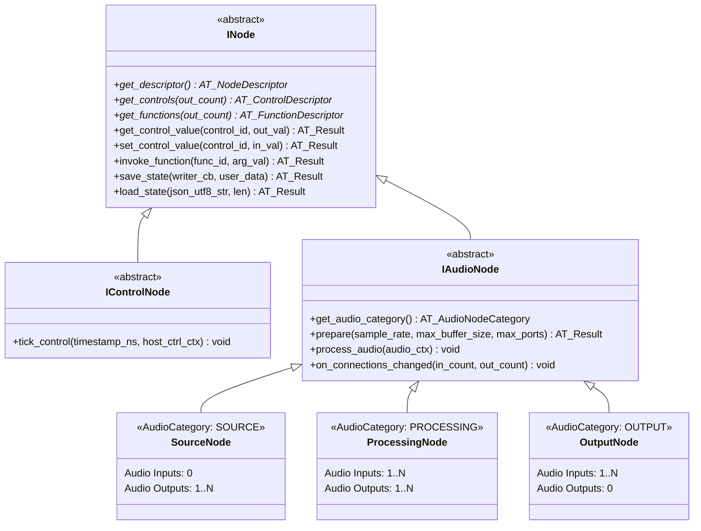

# 02 — Node & Plugin ABI/API Specification

## 1. Conceptual Node Hierarchy

As required by `requirements.md`:
> *"There are 2 groups of nodes, audio nodes: source nodes, output nodes and processing nodes... The second group is control nodes. They have only control input and output. In code inheritance hierarchy, the only difference is that the control nodes do not have audio inputs or outputs. Their entire purpose is to exist on the control plane and trigger functions."*

### 1.1 C++ Class Hierarchy (SDK Wrapper Layer)



---

## 2. Dynamic DLL Loading: What Must Be Specified in the ABI?

Requirement 37 asks:
> *"Nodes functions can be loaded dynamically from dlls. What everything needs to be specified in the API for it to work correctly?"*

Loading C++ objects across Windows DLLs (`LoadLibraryW` / `GetProcAddress`) is notoriously fragile if raw C++ classes or STL types (`std::string`, `std::vector`, `std::function`) are passed across the boundary. To make the plugin system rock-solid across different MSVC toolsets, Debug/Release builds, or even Clang/Rust/C plugins, **the ABI boundary MUST specify the following 8 guarantees**:

### 2.1 The 8 Pillars of Cross-DLL ABI Safety

1. **Pure `extern "C"` Entry Point & Explicit Calling Convention (`__cdecl`):**
   - C++ name mangling differs between compilers and compiler versions. Every DLL exports a single unmangled entry point:
     `AT_PLUGIN_EXPORT const AT_PluginExportBundle* AT_CDECL at_get_plugin_bundle(uint32_t host_abi_version);`
2. **ABI Version Negotiation (`AT_ABI_VERSION`):**
   - Structs include a `uint32_t struct_size = sizeof(...)` and semantic ABI version (`0x00010000` for v1.0). If a DLL was compiled against an incompatible ABI, the host rejects it gracefully without crashing.
3. **Zero STL Types Across the Boundary:**
   - Layouts of `std::string`, `std::vector`, and `std::map` change between MSVC `/MD` (Release) and `/MDd` (Debug).
   - All strings across the boundary are **UTF-8 null-terminated `const char*`** with explicit byte lengths. All arrays are `const T* ptr` + `uint32_t count`.
4. **Strict Heap Ownership Symmetry (CRT Isolation):**
   - Memory allocated inside the DLL (`new` / `malloc` using the DLL's CRT heap) **MUST NEVER** be freed by the Host EXE (`delete` / `free` using the Host's CRT heap), and vice versa.
   - Nodes are created via `plugin->create_node(...)` and destroyed exclusively via `plugin->destroy_node(node_handle)`.
   - State serialization uses a **Host-provided Writer Callback** (`void (*write_fn)(void* ctx, const char* data, size_t len)`) so the DLL never returns heap-allocated strings that the host has to free.
5. **No C++ Exceptions Across DLL Boundaries (`noexcept`):**
   - Throwing a C++ exception across a DLL boundary causes immediate undefined behavior / `std::terminate`. All ABI functions return an `AT_Result` status code (`AT_OK = 0`, negative values for errors) and the C++ SDK wrapper catches any internal exceptions inside the DLL before returning.
6. **Explicit Struct Packing (`#pragma pack(push, 8)`):**
   - Guarantees identical field offsets regardless of compiler packing flags.
7. **Host Services VTable (`AT_HostServices`):**
   - Passed to the DLL upon initialization. Gives the DLL safe callbacks into the engine for:
     - Emitting a Control Plane output pulse (`emit_control_output`).
     - Notifying the host that the node's control list changed dynamically (`notify_controls_dirty`, e.g., when `VolumeNode` gains a new input connection).
     - Querying available Windows audio devices (`enumerate_audio_devices`) or requesting shared hardware capture/render buses (`acquire_hardware_device`).
     - Thread-safe logging (`log_message`).
8. **Shadow-Copy Loading for Hot-Reloading:**
   - Windows locks `.dll` and `.pdb` files on disk while loaded via `LoadLibraryW`.
   - User-configurable plugins live in `%LOCALAPPDATA%\Rouvr\AudioTool\plugins\`. Before loading `%LOCALAPPDATA%\Rouvr\AudioTool\plugins\Audio\VolumeNode.dll`, the Engine copies it to `%LOCALAPPDATA%\Rouvr\AudioTool\cache\plugin_shadow\VolumeNode_<timestamp>.dll` and loads the copy. This allows developers to recompile or replace plugins in `%LOCALAPPDATA%\Rouvr\AudioTool\plugins\` and hot-reload them at runtime without closing AudioTool.

---

## 3. Complete C ABI Header Specification (`at_abi.h`)

Below is the exact logical contract to be implemented in `include/at_sdk/at_abi.h`:

### 3.1 Core Enumerations & Primitives

```c
#pragma pack(push, 8)

#define AT_ABI_VERSION 0x00010000

typedef int32_t AT_Result;
#define AT_OK                    0
#define AT_ERR_INVALID_ARG      -1
#define AT_ERR_OUT_OF_MEMORY    -2
#define AT_ERR_NOT_FOUND        -3
#define AT_ERR_ABI_MISMATCH     -4
#define AT_ERR_DEVICE_FAILURE   -5

typedef enum AT_NodePlaneType {
    AT_NODE_PLANE_AUDIO   = 0,  // Has Audio I/O + Control I/O (IAudioNode)
    AT_NODE_PLANE_CONTROL = 1   // Has Control I/O ONLY (IControlNode)
} AT_NodePlaneType;

typedef enum AT_AudioNodeCategory {
    AT_AUDIO_CAT_NONE       = 0, // Used by Control Nodes
    AT_AUDIO_CAT_SOURCE     = 1, // 0 Audio Inputs, 1..N Audio Outputs (e.g., VirtualInput, Playback)
    AT_AUDIO_CAT_PROCESSING = 2, // 1..N Audio Inputs, 1..N Audio Outputs (e.g., Volume, EQ, Reverb)
    AT_AUDIO_CAT_OUTPUT     = 3  // 1..N Audio Inputs, 0 Audio Outputs (e.g., OutputNode)
} AT_AudioNodeCategory;

typedef enum AT_NodeFlags {
    AT_NODE_FLAG_NONE              = 0,
    AT_NODE_FLAG_AUTO_SUM_INPUTS   = (1 << 0), // Host pre-sums all connected inputs into bus 0
    AT_NODE_FLAG_DYNAMIC_CONTROLS  = (1 << 1), // Control list changes when connections change (e.g. VolumeNode)
    AT_NODE_FLAG_PRODUCES_TAIL     = (1 << 2)  // Node outputs audio after input stops (e.g. Reverb)
} AT_NodeFlags;
```

### 3.2 Control Descriptors & Preferred UI Styles

Requirements 24–32 specify that every node exposes a list of controls along with **preferred visual styles** so the GUI knows how to render them inside the expanded node table.

```c
typedef enum AT_ValueType {
    AT_VAL_NONE   = 0,
    AT_VAL_BOOL   = 1,
    AT_VAL_INT    = 2,
    AT_VAL_FLOAT  = 3,
    AT_VAL_STRING = 4
} AT_ValueType;

typedef enum AT_ControlType {
    AT_CTRL_SLIDER              = 0, // Continuous or stepped range {min, max, step}
    AT_CTRL_BUTTON              = 1, // Momentary action button or toggle on/off
    AT_CTRL_FILE_SELECTOR       = 2, // Opens file browser with extension filters
    AT_CTRL_AUDIO_DEVICE_SELECT = 3, // Dropdown of Windows audio devices (filtered by Capture/Render)
    AT_CTRL_VALUE_TEXT_INPUT    = 4, // Text/selection from predefined list of allowed values
    AT_CTRL_RANGE_TEXT_INPUT    = 5, // Numeric text box bounded by {min, max} (float or int)
    AT_CTRL_LEVEL_METER         = 6, // Additional: Read-only VU/Peak dB bar meter
    AT_CTRL_STATUS_LABEL        = 7  // Additional: Read-only diagnostic/timecode text
} AT_ControlType;

typedef enum AT_PreferredStyle {
    // Generic
    AT_STYLE_DEFAULT            = 0,
    // Styles for AT_CTRL_SLIDER
    AT_STYLE_HORIZONTAL_SLIDER  = 1, // Standard horizontal bar slider
    AT_STYLE_VERTICAL_SLIDER    = 2, // Mixing-console fader style
    AT_STYLE_ROTARY_KNOB        = 3, // Circular synth/mixer knob
    AT_STYLE_SELECTOR_SWITCH    = 4, // Discrete notched rotary/stepped switch
    // Styles for AT_CTRL_BUTTON
    AT_STYLE_PUSH_BUTTON        = 5, // Momentary click button (fires once on click)
    AT_STYLE_TOGGLE_BUTTON      = 6, // Latched On/Off toggle button
    AT_STYLE_CHECKBOX           = 7, // Standard checkbox
    AT_STYLE_TRIGGER_PAD        = 8, // Soundboard MPC-style pad (lights up while playing)
    // Styles for AT_CTRL_VALUE_TEXT_INPUT
    AT_STYLE_DROPDOWN_COMBO     = 9, // Dropdown select box
    AT_STYLE_RADIO_GROUP        = 10,// Inline segmented radio buttons
    AT_STYLE_AUTOCOMPLETE_TEXT  = 11,// Editable text box with autocomplete suggestions
    // Styles for AT_CTRL_RANGE_TEXT_INPUT
    AT_STYLE_NUMERIC_BOX        = 12,// Type-in numeric box
    AT_STYLE_SPINBOX            = 13,// Numeric box with +/- step buttons
    AT_STYLE_DRAG_SCALAR        = 14 // Click-and-drag numeric box
} AT_PreferredStyle;

typedef enum AT_AudioDeviceFilter {
    AT_DEV_FILTER_INPUT_CAPTURE  = (1 << 0), // Microphones, Line-In
    AT_DEV_FILTER_OUTPUT_RENDER  = (1 << 1), // Speakers, Virtual Audio Cables
    AT_DEV_FILTER_LOOPBACK       = (1 << 2)  // WASAPI Desktop/Device Loopback capture
} AT_AudioDeviceFilter;

typedef struct AT_ControlValue {
    AT_ValueType type;
    union {
        bool        bool_val;
        int64_t     int_val;
        double      float_val;
        const char* string_val; // UTF-8
    };
} AT_ControlValue;

typedef struct AT_ControlDescriptor {
    uint32_t          control_id;       // Stable unique ID within the node (e.g., 100)
    const char*       identifier;       // Serialization key (e.g., "master_gain_db")
    const char*       display_name;     // UI label in table row (e.g., "Master Gain")
    const char*       unit_label;       // Optional unit suffix (e.g., "dB", "Hz", "ms", "%")
    AT_ControlType    control_type;     // Slider, Button, FileSelector, etc.
    AT_PreferredStyle preferred_style;  // Knob, Horizontal Slider, Toggle Button, etc.
    AT_ValueType      value_type;       // BOOL, INT, FLOAT, STRING

    // Numeric bounds (for SLIDER, RANGE_TEXT_INPUT, LEVEL_METER)
    double            min_value;
    double            max_value;
    double            step_value;       // 0.0 for continuous
    bool              is_logarithmic;   // True for frequency (20Hz-20kHz) or gain sliders

    // Default value
    AT_ControlValue   default_value;

    // Type-specific metadata
    const char*       file_filters;     // For FILE_SELECTOR: e.g., "Audio Files (*.wav;*.mp3;*.ogg)|*.wav;*.mp3;*.ogg"
    uint32_t          device_filter;    // For AUDIO_DEVICE_SELECT: bitmask of AT_AudioDeviceFilter
    const char* const* predefined_values; // For VALUE_TEXT_INPUT: array of allowed UTF-8 strings
    uint32_t          predefined_count;
} AT_ControlDescriptor;
```

### 3.3 Exposeable Functions (Actions) for Control Plane & GUI Binding

Requirement 34 & 59 specify:
> *"Nodes should have a list of available functions with their names so that the GUI can do things like binding a GUI event to for example 'set volume to 0', 'lower volume by 10', 'increase this parameter'... Functions should have also specified parameter types - int, float, min/max values."*
> *"When connecting a data output to a node, the receiver node should on select display a context menu with a list of all functions available - where a integer/float value is needed, the number can be supplied with a popup dialog upon selecting the function."*

To support this cleanly, every node exposes an array of `AT_FunctionDescriptor` items:

```c
typedef enum AT_FunctionOpKind {
    AT_OP_ACTION_TRIGGER = 0, // Parameterless command (e.g., "Toggle Mute", "Play Sound", "Normalize All")
    AT_OP_SET_PARAMETER  = 1, // Sets parameter to exact value X (e.g., "Set Master Volume to [X] dB")
    AT_OP_ADD_PARAMETER  = 2  // Adds delta X to current parameter (e.g., "Change Master Volume by [+/-X] dB")
} AT_FunctionOpKind;

typedef struct AT_FunctionDescriptor {
    uint32_t          function_id;      // Stable ID within the node (e.g., 1001)
    const char*       identifier;       // Serialization key (e.g., "add_master_volume")
    const char*       display_name;     // Context menu name (e.g., "Change Volume By (dB)...")
    const char*       description;      // Tooltip description
    AT_FunctionOpKind op_kind;          // TRIGGER, SET, or ADD
    uint32_t          target_control_id;// Linked control_id if this mutates a control (or 0)

    // Parameter specification (if parameter_type == AT_VAL_NONE, no popup dialog is needed!)
    AT_ValueType      parameter_type;   // AT_VAL_NONE, AT_VAL_INT, AT_VAL_FLOAT, AT_VAL_BOOL
    const char*       parameter_name;   // Label in popup dialog (e.g., "Delta Volume (dB)")
    const char*       parameter_unit;   // e.g., "dB", "ms", "%"
    double            min_value;        // Min allowed in popup dialog (e.g., -100.0)
    double            max_value;        // Max allowed in popup dialog (e.g., +100.0)
    double            default_value;    // Pre-filled value in popup dialog (e.g., -10.0)
} AT_FunctionDescriptor;
```

**Automatic Function Generation Convenience (SDK Feature):**
In our C++ helper base class (`at_node_base.hpp`), whenever a plugin author registers a numeric control (e.g., `"Master Volume"`, `-60.0` to `+12.0 dB`), the SDK can **automatically generate three standard functions** for it without boilerplate:
1. `"Set Master Volume..."` (`AT_OP_SET_PARAMETER`, float `[-60.0, +12.0]`)
2. `"Adjust Master Volume By..."` (`AT_OP_ADD_PARAMETER`, float `[-72.0, +72.0]`)
3. `"Reset Master Volume to Default"` (`AT_OP_ACTION_TRIGGER`, `AT_VAL_NONE`)
And for any boolean toggle control (e.g., `"Mute"`):
1. `"Toggle Mute"` (`AT_OP_ACTION_TRIGGER`, `AT_VAL_NONE`)
2. `"Set Mute On/Off..."` (`AT_OP_SET_PARAMETER`, `AT_VAL_BOOL`)
Plugin authors can also register custom functions (such as `"Normalize All Inputs Now"` on `VolumeNode` or `"Restart Playback"` on `PlaybackNode`).

### 3.4 Audio Process Context & Buffer Structs

```c
typedef struct AT_AudioBusView {
    uint32_t      source_node_id;   // ID of the upstream node feeding this bus (0 if output bus)
    const char*   source_node_name; // Display name of upstream node (useful for VolumeNode labels)
    uint32_t      num_channels;     // Typically 2 (Stereo)
    uint32_t      num_frames;       // Engine buffer_size (e.g., 256)
    float* const* channel_ptrs;     // Array of [num_channels] pointers, each 64-byte aligned float[num_frames]
} AT_AudioBusView;

typedef struct AT_AudioProcessContext {
    uint32_t               sample_rate;
    uint32_t               num_frames;
    uint64_t               sample_timestamp;
    uint32_t               input_bus_count;   // Number of connected upstream audio nodes (0 .. max_connections)
    const AT_AudioBusView* input_buses;       // Array of [input_bus_count] individual upstream buses
    AT_AudioBusView        output_bus;        // This node's output bus to write into
} AT_AudioProcessContext;
```

---

## 4. Specification of Required Built-in Nodes

Below is the detailed specification of each node type required by `requirements.md`.

### 4.1 `VirtualInputNode` (Category: `SOURCE`, Plane: `AUDIO`)
- **Purpose:** Captures audio from an existing Windows audio input device (e.g., physical microphone) or loopback endpoint and outputs it to downstream nodes. Multiple `VirtualInputNode` instances can listen to the same Windows device via the `HardwareDeviceManager`'s Hidden Master Input Node.
- **Audio I/O:** `0` Inputs, `1..max_connections` Outputs.
- **Controls:**
  1. `device_id` (`AT_CTRL_AUDIO_DEVICE_SELECT`, filter: `AT_DEV_FILTER_INPUT_CAPTURE | AT_DEV_FILTER_LOOPBACK`, style: `AT_STYLE_DROPDOWN_COMBO`) — Selects the Windows audio input device.
  2. `input_gain_db` (`AT_CTRL_SLIDER`, float `-60.0` to `+24.0 dB`, default `0.0`, style: `AT_STYLE_HORIZONTAL_SLIDER`) — Pre-gain trim.
  3. `mute` (`AT_CTRL_BUTTON`, bool, default `false`, style: `AT_STYLE_TOGGLE_BUTTON`) — Mutes capture output.
  4. `peak_meter` (`AT_CTRL_LEVEL_METER`, float `-60.0` to `0.0 dB`) — Visual input level indicator.
- **Exposed Functions:**
  - `Toggle Mute` (`AT_VAL_NONE`)
  - `Set Mute` (`AT_VAL_BOOL`)
  - `Set Input Gain (dB)` (`AT_VAL_FLOAT`, `[-60, +24]`)
  - `Change Input Gain By (dB)` (`AT_VAL_FLOAT`, `[-84, +84]`)

### 4.2 `PlaybackNode` / Soundboard Node (Category: `SOURCE`, Plane: `AUDIO`)
- **Purpose:** Plays an audio file (`.wav`, `.mp3`, `.flac`, `.ogg`) from disk/RAM into its audio output.
- **Audio I/O:** `0` Inputs, `1..max_connections` Outputs.
- **Controls:**
  1. `file_path` (`AT_CTRL_FILE_SELECTOR`, filters: `"*.wav;*.mp3;*.ogg;*.flac"`, style: `AT_STYLE_DEFAULT`) — Audio clip file selector.
  2. `play_trigger` (`AT_CTRL_BUTTON`, bool, style: `AT_STYLE_TRIGGER_PAD`) — Starts/retriggers playback.
  3. `stop_button` (`AT_CTRL_BUTTON`, bool, style: `AT_STYLE_PUSH_BUTTON`) — Stops playback and resets playhead.
  4. `loop_enabled` (`AT_CTRL_BUTTON`, bool, default `false`, style: `AT_STYLE_CHECKBOX`) — Loop continuously.
  5. `retrigger_mode` (`AT_CTRL_VALUE_TEXT_INPUT`, predefined: `["Restart", "Overlap/Polyphonic", "Play/Pause"]`, style: `AT_STYLE_DROPDOWN_COMBO`).
  6. `volume_db` (`AT_CTRL_SLIDER`, float `-60.0` to `+12.0 dB`, default `0.0`, style: `AT_STYLE_HORIZONTAL_SLIDER`).
  7. `playback_speed` (`AT_CTRL_RANGE_TEXT_INPUT`, float `0.25` to `4.0`, default `1.0`, style: `AT_STYLE_SPINBOX`).
- **Exposed Functions:**
  - `Play / Retrigger` (`AT_VAL_NONE`)
  - `Stop Playback` (`AT_VAL_NONE`)
  - `Toggle Play/Pause` (`AT_VAL_NONE`)
  - `Toggle Loop` (`AT_VAL_NONE`)
  - `Set Volume (dB)` (`AT_VAL_FLOAT`, `[-60, +12]`)
  - `Change Volume By (dB)` (`AT_VAL_FLOAT`, `[-72, +72]`)

### 4.3 `VolumeNode` / Multi-Channel Mixer & Normalizer (Category: `PROCESSING`, Plane: `AUDIO`)
- **Purpose:** Specifically required by line 14: *"for each input node, provides channel volume control, able to normalize sound volume across all input nodes"*.
- **Flags:** `AT_NODE_FLAG_DYNAMIC_CONTROLS` (does **NOT** set `AT_NODE_FLAG_AUTO_SUM_INPUTS` because it processes each input bus separately!).
- **Audio I/O:** `1..max_connections` Inputs, `1..max_connections` Outputs.
- **Controls:**
  - **Dynamic Per-Input Controls** (generated for each connected input slot `i = 0 .. N-1`, labeled with the upstream node's name):
    - `input_gain_db[i]` (`AT_CTRL_SLIDER`, float `-60.0` to `+24.0 dB`, default `0.0`, style: `AT_STYLE_HORIZONTAL_SLIDER`)
    - `input_mute[i]` (`AT_CTRL_BUTTON`, bool, default `false`, style: `AT_STYLE_TOGGLE_BUTTON`)
  - **Master & Normalization Controls:**
    - `auto_normalize_enabled` (`AT_CTRL_BUTTON`, bool, default `false`, style: `AT_STYLE_TOGGLE_BUTTON`) — Continuously measures integrated LUFS / Short-Term RMS (`tau = 400 ms`) across each active input and applies makeup attenuation/gain (bounded by `max_norm_boost_db`) so all inputs match `target_norm_level_db`.
    - `target_norm_level_db` (`AT_CTRL_RANGE_TEXT_INPUT`, float `-40.0` to `0.0 dB`, default `-16.0 dB`, style: `AT_STYLE_SPINBOX`).
    - `master_volume_db` (`AT_CTRL_SLIDER`, float `-60.0` to `+12.0 dB`, default `0.0`, style: `AT_STYLE_ROTARY_KNOB`).
    - `master_mute` (`AT_CTRL_BUTTON`, bool, default `false`, style: `AT_STYLE_TOGGLE_BUTTON`).
- **Exposed Functions:**
  - `Set Master Volume (dB)` (`AT_VAL_FLOAT`, `[-60, +12]`)
  - `Change Master Volume By (dB)` (`AT_VAL_FLOAT`, `[-72, +72]`)
  - `Set Input 1..N Volume (dB)` (`AT_VAL_FLOAT`, `[-60, +24]`)
  - `Change Input 1..N Volume By (dB)` (`AT_VAL_FLOAT`, `[-84, +84]`)
  - `Toggle Master Mute` (`AT_VAL_NONE`)
  - `Toggle Auto-Normalize` (`AT_VAL_NONE`)
  - `Normalize Inputs Snapshot Now` (`AT_VAL_NONE` — computes current RMS ratios of active inputs and sets their sliders to match levels immediately).

### 4.4 `EqualizerNode` & `ReverbNode` (Category: `PROCESSING`, Plane: `AUDIO`)
- **`EqualizerNode` (3-Band Parametric EQ):**
  - Flags: `AT_NODE_FLAG_AUTO_SUM_INPUTS`.
  - Controls: `low_gain_db` (`Knob`), `low_freq_hz` (`RangeTextInput`, 20–500 Hz), `mid_gain_db` (`Knob`), `mid_freq_hz` (`RangeTextInput`, 200–5000 Hz), `mid_q` (`Slider`), `high_gain_db` (`Knob`), `high_freq_hz` (`RangeTextInput`, 2000–20000 Hz), `bypass` (`ToggleButton`).
  - Implementation: Cascaded RBJ Biquad filters with per-sample coefficient smoothing.
- **`ReverbNode` (Stereo Algorithmic Reverb - Freeverb/Dattorro topology):**
  - Flags: `AT_NODE_FLAG_AUTO_SUM_INPUTS | AT_NODE_FLAG_PRODUCES_TAIL`.
  - Controls: `room_size` (`RotaryKnob`, 0.0–1.0), `damping` (`RotaryKnob`, 0.0–1.0), `wet_dry_mix` (`HorizontalSlider`, 0–100%), `pre_delay_ms` (`RangeTextInput`, 0–200 ms), `bypass` (`ToggleButton`).

### 4.5 `OutputNode` (Category: `OUTPUT`, Plane: `AUDIO`)
- **Purpose:** Sends mixed audio to a selected Windows audio playback device (e.g., Speakers, Headphones, VB-Cable / Virtual Audio Cable). Multiple `OutputNode` instances can write to the same Windows device simultaneously via the `HardwareDeviceManager`'s Hidden Master Output Node.
- **Audio I/O:** `1..max_connections` Inputs, `0` Outputs.
- **Controls:**
  1. `device_id` (`AT_CTRL_AUDIO_DEVICE_SELECT`, filter: `AT_DEV_FILTER_OUTPUT_RENDER`, style: `AT_STYLE_DROPDOWN_COMBO`).
  2. `output_gain_db` (`AT_CTRL_SLIDER`, float `-60.0` to `+12.0 dB`, default `0.0`, style: `AT_STYLE_HORIZONTAL_SLIDER`).
  3. `mute` (`AT_CTRL_BUTTON`, bool, default `false`, style: `AT_STYLE_TOGGLE_BUTTON`).
  4. `output_meter` (`AT_CTRL_LEVEL_METER`, float `-60.0` to `0.0 dB`).

### 4.6 `TimerControlNode` (Category: `NONE`, Plane: `CONTROL`)
- **Purpose:** Required by line 59: *"Do not implement keyboard control node yet, only a simple example timer node, that has one text box configuration that sends a pulse on its data output every [option] ms."*
- **Audio I/O:** None (`AT_NODE_PLANE_CONTROL`).
- **Control I/O:** `1..max_connections` Control Inputs (can be started/stopped/reset by another control node), `1..max_connections` Control Outputs.
- **Controls:**
  1. `interval_ms` (`AT_CTRL_RANGE_TEXT_INPUT`, `AT_VAL_INT`, min: `10`, max: `3600000` (1 hour), default: `1000`, unit: `"ms"`, style: `AT_STYLE_NUMERIC_BOX`) — Text box specifying pulse period in milliseconds.
  2. `enabled` (`AT_CTRL_BUTTON`, `AT_VAL_BOOL`, default: `true`, style: `AT_STYLE_TOGGLE_BUTTON`) — Enables/pauses timer firing.
- **Exposed Functions (Control Input Targets):**
  - `Toggle Timer Enabled` (`AT_VAL_NONE`)
  - `Reset Timer Phase` (`AT_VAL_NONE`)
  - `Set Interval (ms)` (`AT_VAL_INT`, `[10, 3600000]`)
- **Runtime Behavior:**
  - Inside `tick_control(timestamp_ns, ctx)`, when `enabled == true` and `timestamp_ns - last_fire_ns >= interval_ms * 1,000,000`, it advances `last_fire_ns` and calls `host->emit_control_output(node_handle, 0)` which triggers all bound downstream functions on the Control Plane.

